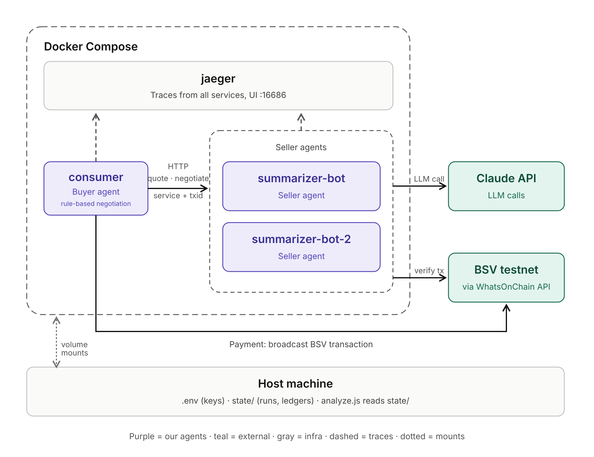
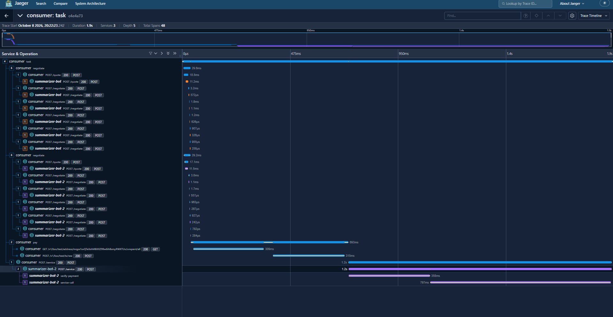

# BSV agent payments

AI agents that negotiate prices with each other and pay automatically with small
BSV payments (testnet). A buyer agent asks competing seller agents for a price,
negotiates, pays the cheapest one, and the seller delivers only after it has
verified the payment on-chain. Built as the prototype for a bachelor's thesis.



## How one task works

1. The buyer asks every seller of the right service for a quote.
2. It negotiates with all of them in parallel (up to 5 rounds each).
3. It pays the cheapest agreed price with a BSV testnet transaction.
4. It asks the winner for the service, sending the transaction id as proof.
5. The seller checks the payment on-chain, calls the LLM, and returns the result.

Every task is one trace in Jaeger, across all containers.



## Quick start (Docker)

You need Docker Desktop, Node.js 18+ and some testnet coins.

```bash
npm install
node setup-env.js       # creates .env with testnet keys
node add-agents.js      # adds the remaining seller keys
node show-address.js    # the buyer's address: fund it from a BSV testnet faucet
```

Add your `ANTHROPIC_API_KEY` to `.env` (without it the sellers answer with mock text).
Then:

```bash
docker compose up --build -d jaeger summarizer-bot summarizer-bot-2
docker compose run --rm consumer          # one session; repeat as often as you like
```

Open Jaeger at http://localhost:16686, choose service `consumer`, and open a trace.

Git Bash on Windows rewrites paths that start with `/`. For commands that use a path
inside a container, prefix them with `MSYS_NO_PATHCONV=1`.

## Results and analysis

- `state/consumer/runs.json`: the buyer's view of every task (prices, timings, trace id).
- `state/<seller>/ledger-<seller>.jsonl`: each seller's own books (real cost, margin).

```bash
node analyze.js --state state           # outcomes, money, cost-estimate accuracy, latency
node analyze.js --state state --csv     # one row per task, for Excel or Power BI
```

`analyze.js` joins the two on the transaction id, because only the seller knows what
a task really cost.
Every payment is also shown in US dollars, together with the network fee of the payment
transaction itself (in the test runs about 23 satoshis, roughly $0.000004 per payment).

## Design in brief

- **Negotiation:** alternating offers. The seller concedes from its ask towards a
  private floor; the buyer starts at half the ask and concedes towards its budget.
- **Pricing:** each seller estimates what a request will cost (tokens in and out)
  and adds a margin. Prices are set in USD and converted to satoshis at the current
  BSV/USD rate.
- **Pay before delivery:** `/service` answers *402 Payment Required* until the seller
  has seen the payment. One payment buys exactly one delivery.
- **Wallet:** spends its own change from earlier payments first (kept in
  `wallet-txs.json`) and asks the indexer only when it has to. A failed payment is
  recorded and the session continues.
- **Tracing:** OpenTelemetry, exported to Jaeger. HTTP spans are named by route.

## Limitations

- Testnet only. Payments are accepted before block confirmation (0-conf).
- No escrow: a seller could take a payment and not deliver.
- Depends on one indexer (WhatsOnChain) for balances, broadcasting and verification.
- A seller's cost estimate can be lower than the real cost, which would mean a loss.
- Only the two summarizer agents run in containers. Other agent types exist only in
  the single-process version (`full-pipeline.js`).

## Security

`.env` holds private keys and the Claude API key. Never commit it (it is in
`.gitignore`) and check the git history before publishing the repository. Docker
Compose gives each service only its own secrets, and nothing secret is built into the
image. These are testnet keys; real money would need a key manager and spending
limits.

## Project layout

| File | Purpose |
|---|---|
| `agent-server.js` | A seller agent as an HTTP service |
| `consumer-remote.js` | The buyer agent |
| `negotiate.js` | Negotiation strategy shared by buyer and sellers |
| `providers.js` | Seller definitions and price quotes |
| `payment.js`, `chain.js`, `verify.js` | Wallet, WhatsOnChain API, payment check |
| `pricing.js`, `rate.js` | Cost estimates and the BSV/USD rate |
| `ai-service.js` | The Claude API call |
| `tracing.js`, `spans.js` | OpenTelemetry setup |
| `analyze.js` | Statistics from the logs |
| `data/tasks.js` | The tasks the buyer runs |
| `Dockerfile`, `docker-compose.yml` | Containers |

Other scripts:

- `full-pipeline.js`: everything in one process, with all agent types.
- `print-shop.js`: a pay-per-print prototype, with `invoice.js`, `printing.js`,
  `pay-invoice.js` and `print-key.js`.
- `update-rate.js`: fetches the BSV/USD rate by hand.
- `wallet.js`, `consumer.js`, `provider.js`, `run-negotiation.js`: the first prototypes,
  kept for reference.

How the design evolved is in [CHANGELOG.md](CHANGELOG.md).
